# JojoPen — Complete Feature Reference

**Tested against:** <https://jojopen.com/> (production build `index-CBB3_Z2F.js`) on **14 Nov 2026**, driven live in headless Chrome via the DevTools Protocol at 1440×900.

**Current site (16 Nov 2026):** bundle `index-Dvu7dF-m.js` introduces a compact rounded
chrome, hover key hints, a `system` theme, `Random colors`, `Size 1×` / `Clean it` in the
context bar and a **Sign in** chip; cloud boards and share/profile links remain gated.
The React port mirrors this visual refresh in `src/styles/newui.css`.

**Companion artifact:** [`legacy/index.html`](legacy/index.html) — the original single-file reconstruction of this app, verified end-to-end on 15 Nov 2026 (see [§15.1](#151-reconstruction-checks)). The app now ships as a Vite + React project; see [docs/MIGRATION.md](docs/MIGRATION.md) for the source layout and [docs/AUDIT.md](docs/AUDIT.md) for the audit.

---

## Table of contents

1. [How this document was produced](#1-how-this-document-was-produced)
2. [Product overview](#2-product-overview)
3. [App shell and chrome](#3-app-shell-and-chrome)
4. [Canvas and navigation](#4-canvas-and-navigation)
5. [Tools](#5-tools)
6. [Selection, formatting, arrangement](#6-selection-formatting-arrangement)
7. [Diagrams and the diagram language](#7-diagrams-and-the-diagram-language)
8. [Slides, builds and presenting](#8-slides-builds-and-presenting)
9. [Sands of Time — recording and replay](#9-sands-of-time--recording-and-replay)
10. [AI assistant, Clean it and MCP](#10-ai-assistant-clean-it-and-mcp)
11. [Export](#11-export)
12. [Boards, accounts and sharing](#12-boards-accounts-and-sharing)
13. [Persistence and data model](#13-persistence-and-data-model)
14. [Keyboard shortcuts](#14-keyboard-shortcuts)
15. [Rigorous test log](#15-rigorous-test-log)
16. [Quirks, gaps and unshipped features](#16-quirks-gaps-and-unshipped-features)
17. [References](#17-references)

---

## 1. How this document was produced

Earlier passes could not reach the site through the in-app browser (the desktop browser was disconnected). This pass used a **real Chrome instance driven over CDP**, which is a genuine end-to-end test rather than static bundle reading:

| Item | Value |
|---|---|
| Target | `https://jojopen.com/` |
| Browser | Google Chrome `--headless=new`, 1440×900, DPR 1 |
| Driver | `docs/harness/lib.js` (raw CDP: real mouse/keyboard events, screenshots, console capture) |
| Interactions | Hover, click, drag, right-click, keyboard shortcuts, text input, file-less flows |
| Console errors | **0** across all runs |
| Failed requests | **0** |
| Screenshots | 30 in [`docs/img/`](docs/img/) |
| Dates | 14 Nov 2026 |

The harness scripts are included so the run is reproducible:

```bash
# from the repo root
node docs/harness/suiteA.js     # styles, export, sign-in, palette, selection
node docs/harness/suiteB.js     # selection bar, code panel, slides, presenter
node docs/harness/suiteC.js     # new diagram, Mermaid, recording, AI
node docs/harness/recording.js  # record two shapes
node docs/harness/recording-replay.js  # record → stop → replay
node docs/harness/recording-persistence.js  # prove recordings do not survive reload
```

Rebuild checks (run against the Vite dev server at `http://127.0.0.1:5173/`, same driver):

```bash
node docs/harness/rebuild-e2e.js    # record → replay → GIF/MP4 → Mermaid → builds
node docs/harness/rebuild-keys.js   # replay keyboard control + theme/style sweep
```

Each script writes PNGs to `/tmp/opencode/jojo/suite/`. `lib.js` expects Google Chrome at `/usr/bin/google-chrome`.

**Scope caveat:** anything behind Google sign-in (cloud boards, share links, collections, profiles, MCP pairing) could not be exercised anonymously. Those items are marked **[gated]** and documented from the shipped bundle + the visible sign-in gates.

### Reconstruction coverage

[`legacy/index.html`](legacy/index.html) is a single file with **no network requests at all** (CSS, JS, icons and the Inter/Kalam webfonts are inlined). It implements every anonymous feature in this document — canvas, tools, styles, selection, diagram DSL + Mermaid import, slides/builds/presenter, export, icons, frames, zen mode, assistant scaffolding, and the complete **Sands of Time** record → replay → GIF/MP4 loop. Two deliberate deviations, both noted inline:

- recordings are persisted in the board document (the original keeps them in memory and loses them on reload);
- replay plays in a focused overlay instead of over the undimmed canvas.

Signed-in surfaces (cloud boards, share links, MCP, assistant calls) stay gated in the reconstruction too, matching what an anonymous visitor can reach.

---

## 2. Product overview

JojoPen is a **sketch-style infinite whiteboard for system diagrams, with a built-in slide deck and a drawing recorder**. It is diagram-first rather than freeform-first: nodes carry semantic roles (actor, compute, data, cache, messaging…), edges route orthogonally, and the same content can be laid out as a presentation.

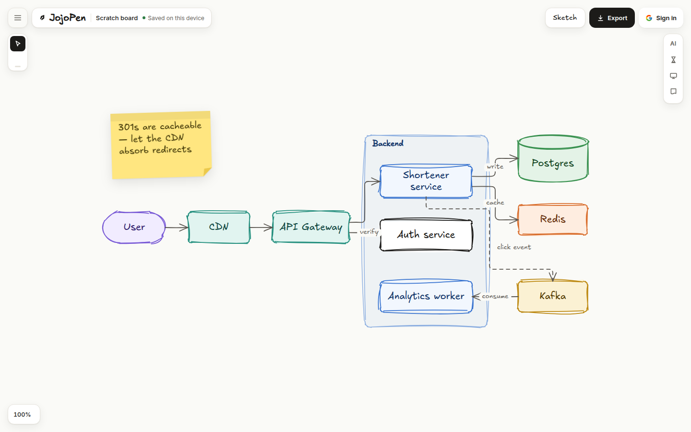

Three things distinguish it from a generic whiteboard:

- **Semantic diagrams with a text DSL** — the diagram is also editable as code and can be imported from Mermaid.
- **Slides that live on the board** — 16:9 slide frames placed anywhere; what you draw inside a frame is on the slide, with builds and speaker notes.
- **Sands of Time** — record your drawing actions, then rewind/replay them, export as GIF/MP4, or use the recording as a slide build.

Anonymous use is a **single “Scratch board”** saved to the browser. Signing in unlocks multiple boards, collections and sharing.

---

## 3. App shell and chrome

### 3.1 Top bar


- **Hamburger** (`aria-label="Main menu"`) — opens the keyboard-shortcut sheet (the same sheet as `?`).
- **Brand + board name** — “JojoPen · Scratch board”. When signed in the name becomes a button titled “Rename or change link”.
- **Save status** — a green dot plus “Saved on this device”.
- **Hover-revealed controls** — the bar is collapsed by default. Hovering the top-right reveals the full set:
  - **Style segmented control**: `Sketch` / `Clean` / `Chalkboard`.
  - **Font** (`Aa`, “Font: Excalifont”) — handwriting font picker (Excalifont, Kalam, …).
  - **B/W** — “Black & white — turn every color off”.
  - **Theme** — system/light/dark toggle.
- **Export** (primary button) — opens the export dialog.
- **Sign in** — “Sign in with Google”, an OAuth redirect (not an in-app dialog).

The chrome is intentionally collapsible: tools and style controls are hidden (`.cp-more`) until hover, which keeps the canvas clean. This is why automation must hover the rail/top-right before clicking hidden controls.

### 3.2 Toolbar (left rail)

Collapsed to a two-icon pill at rest; **expands on hover** into the full vertical tool rail.

| Tool | Shortcut | Notes |
|---|---|---|
| Select | `V` / `1` | Default pointer; marquee selection |
| Hand | `H` | Or hold **Space** |
| Rectangle | `R` | Sketch-drawn rectangle |
| Ellipse | `O` | |
| Diamond | `D` | Decision shape |
| Cylinder | `C` | Database shape |
| Arrow | `A` | Connects shapes; labeled edges |
| Line | `L` | |
| Text | `T` | Inline text editing |
| Pen | `P` | Freehand |
| Sticky note | `S` | Yellow note, inline editor |
| Image | `I` | File picker / drop |
| Diagram frame | `F` | Frame with a `# Diagram` title |
| Eraser | `E` | |
| Laser pointer | `K` | Presentation laser |

Source: `aria-label`/`title` on `.cp-toolbar button`; command registry in the bundle.

### 3.3 Right rail

Always visible, six actions top-to-bottom:

| Icon | `aria-label` | Behaviour |
|---|---|---|
| **AI** | `AI assistant` | Toggles the Assistant panel (`Ctrl+I`) |
| **Hourglass** | `Sands of Time — record what you draw` | Starts/stops recording; shows a red state and live step count |
| **Slide** | `Slides` | Toggles the Slides panel (`Ctrl+Shift+S`) |
| **Book** | `My boards` | Opens My boards (sign-in gate for guests) |
| **Code** | `Diagram code` | Toggles the code panel (`Ctrl+E`) |
| **?** | `Keyboard shortcuts` | Shortcut sheet (`?`) |

### 3.4 Bottom chrome

- **Bottom-left**: collapsed to the zoom label (`100%`). Hover or keyboard focus expands it, left to right, to zoom out, the zoom label (click for 100%), zoom in, **Fit everything** (`Shift+1`), **Snap**, **Dots**, **Random colors**, then a second group with **Undo** (`Ctrl+Z`) and **Redo** (`Ctrl+Shift+Z`). Undo and Redo are disabled when there is no history. Snap and Dots show their active state, and Snap confirms each change with a toast.
- **Bottom-centre**: contextual **format bar** when something is selected (see §6).
- **Toasts** appear bottom-centre, e.g. “Added URL shortener”, “Zen mode · Alt+Z to exit”, “Command palette arrives in step 7”.

---

## 4. Canvas and navigation

- **Infinite canvas** with an SVG/DOM world (`.cp-canvas` → `.cp-world`), not a bitmap.
- **Dot grid** background; toggle with `Ctrl+Shift+'`; snap-to-dots with `Ctrl+'`; hold **Alt** while dragging to place freely.
- **Pan**: hold Space or use the Hand tool; scroll wheel pans; **Ctrl+scroll / pinch** zooms.
- **Zoom**: controls bottom-left, `Ctrl+=` / `Ctrl+-`, `Shift+0` for 100 %, `Shift+1` fit everything, `Shift+2` fit selection. The zoom % is displayed live (e.g. `69%` in slide view).
- **Zen mode** (`Alt+Z`) hides all chrome except the brand and a “Zen mode · Alt+Z to exit” toast.

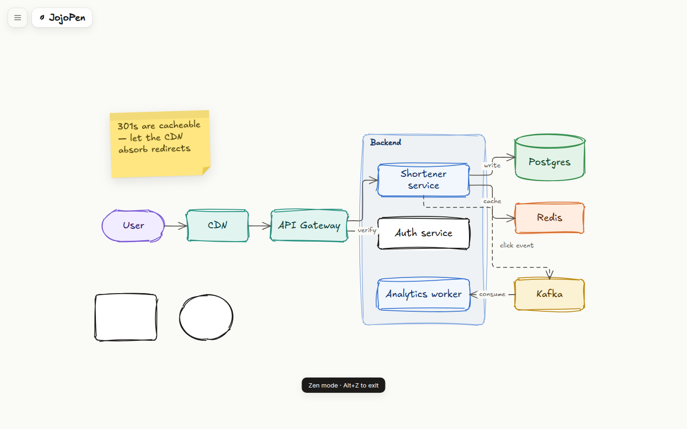

- **Undo/redo** with history (`Ctrl+Z`, `Ctrl+Shift+Z` / `Ctrl+Y`).
- No right-click context menu is registered — actions live in the bottom format bar.

---

## 5. Tools

Everything you draw is a first-class element with position, size, layer order, lock state, role/color, and optional group membership. The default board demonstrates the visual language: hand-drawn containers, coloured role nodes, dashed async edges and labelled arrows.

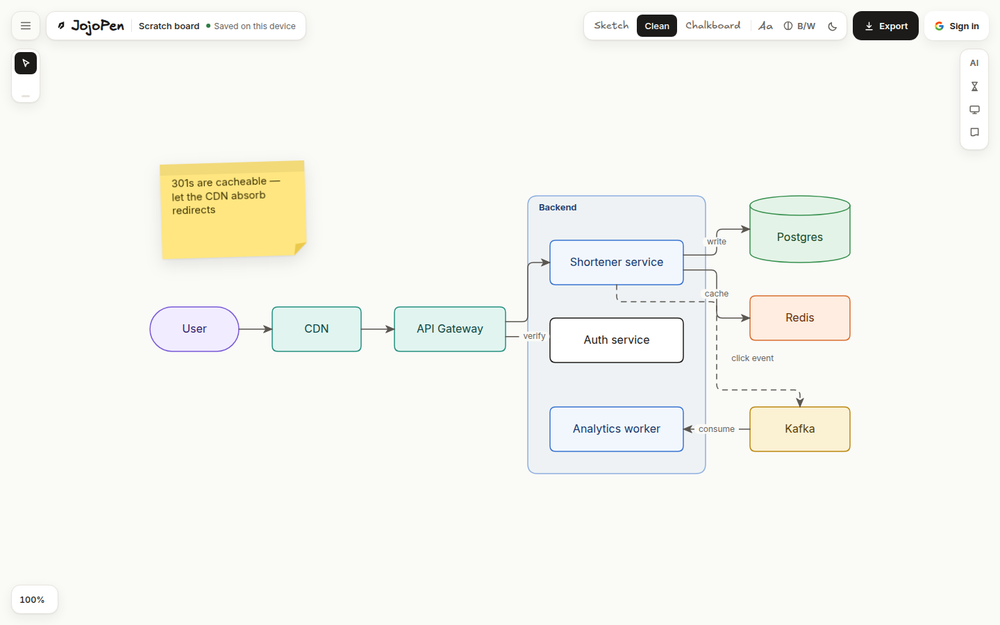
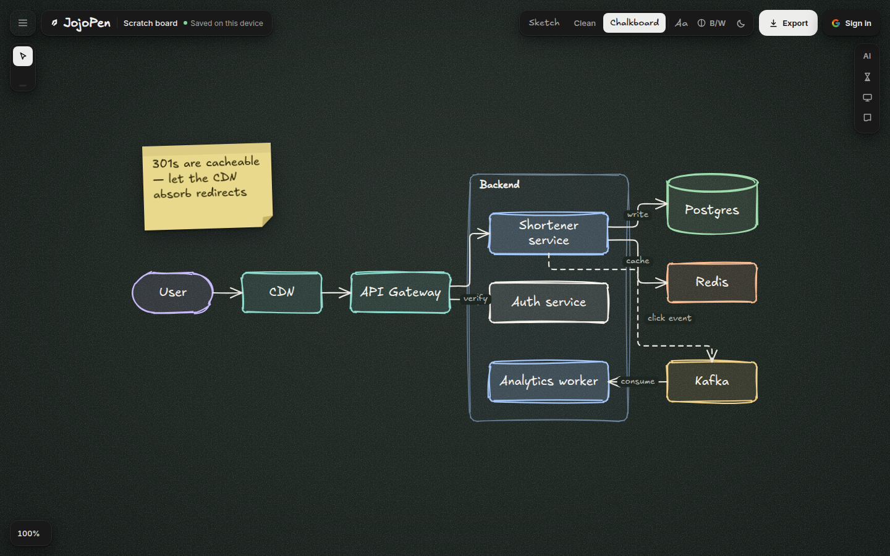

**Board styles**

| Style | Look | Notes |
|---|---|---|
| **Sketch** | Wobbly hand-drawn strokes, handwriting font | Default |
| **Clean** | Straight strokes, UI font | Good for docs |
| **Chalkboard** | Dark chalkboard texture, chalk-coloured strokes | Auto-switches the theme to dark |

**Colour modes**

- Role/auto colours — each node gets a colour from its semantic role (actor, network, compute, data, cache, messaging, security, external, neutral).
- **B/W** — “turn every color off” (still keeps hierarchy via fills).
- **Random colors** — every shape and arrow gets its own colour from the board palette, spread across the roles before repeating. The colours are locked against theme changes, drawn immediately, and recorded as one undoable step (bottom bar).

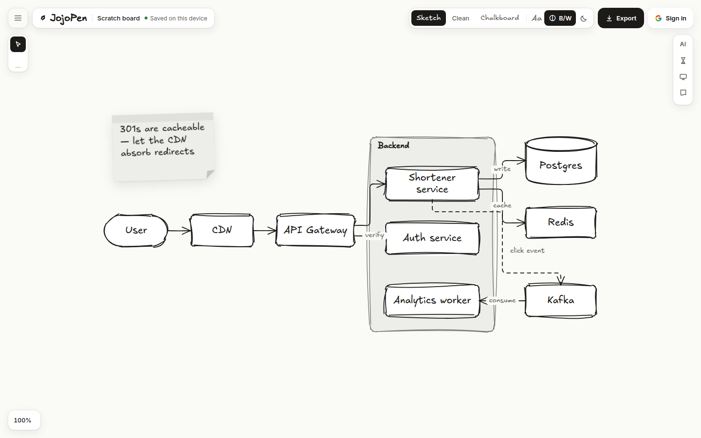
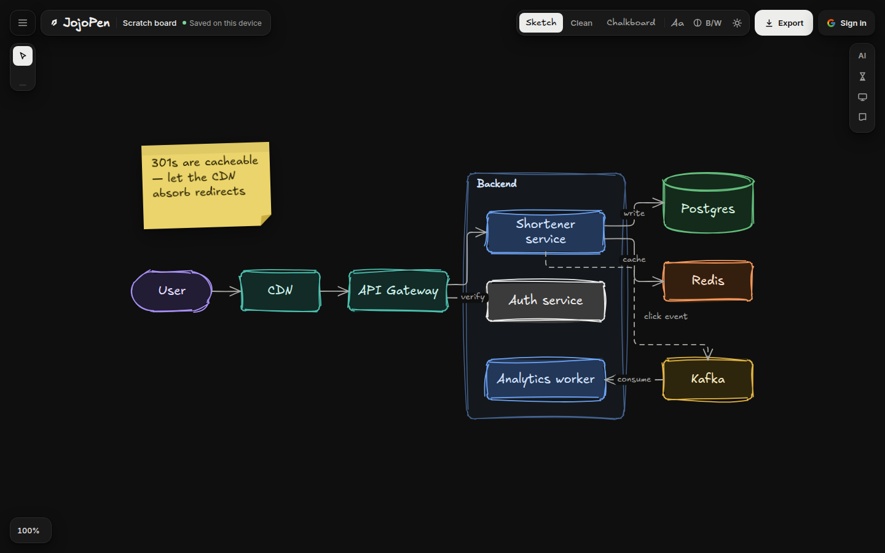

**Sticky notes** are real notes with an inline editor (yellow paper, folded corner), not just coloured rectangles.

**Icons** — press `/` (outside text editing) to open the icon search palette:

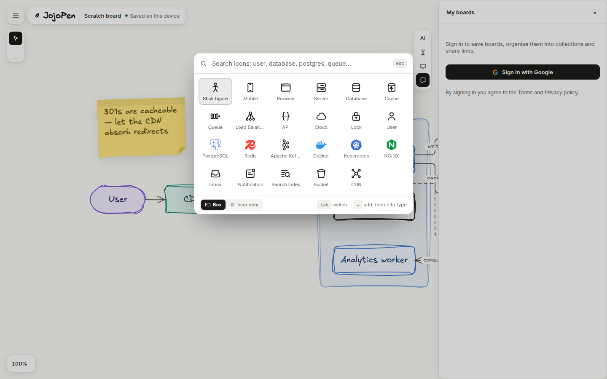

- Search field (“Search icons: user, database, postgres, queue…”).
- Grid of named icons: stick figure, mobile, browser, server, database, cache, queue, load balancer, API, cloud, lock, user, PostgreSQL, Redis, Apache Kafka, Docker, Kubernetes, NGINX, inbox, notification, search index, bucket, CDN, box…
- `Tab` switches, `Enter` adds; “Icon only” option; after inserting, `Enter` types a label.

**Diagram frame** (`F`) — draws a titled frame (`# Diagram`) that groups diagram content; “Tidy up” appears in its format bar.

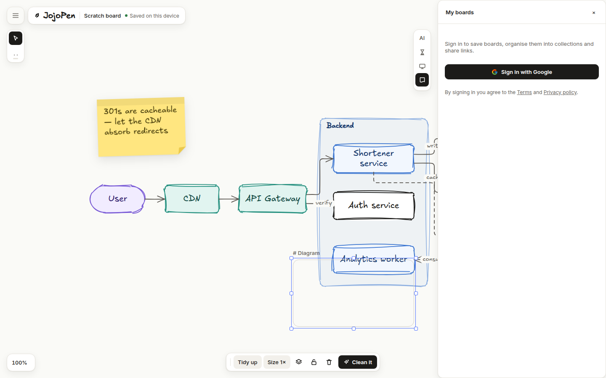

**Images** — `I` opens the OS file picker; images can also be dropped/pasted. (Not captured: OS dialog.)

**Laser pointer** (`K`) — draws a transient laser trail, intended for presenting.

---

## 6. Selection, formatting, arrangement

Clicking an element selects it (blue handles + a floating format bar at the bottom). The bar is context-sensitive.

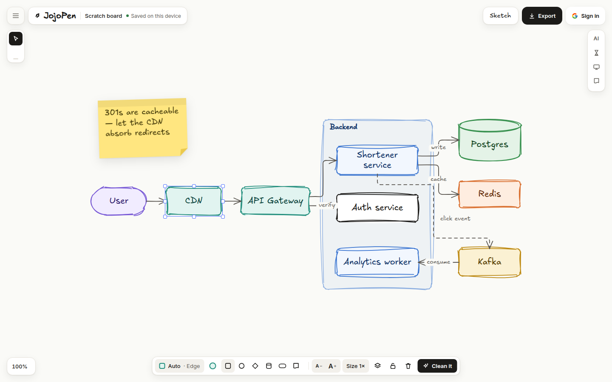

**Node format bar**

| Control | Meaning |
|---|---|
| `Auto · Edge` | Colour is picked automatically from the node name/role; click for the palette |
| Colour dot | Shows the selected element's colour; opens the colour picker and writes the choice as one undoable step |
| Box / Ellipse / Diamond / Cylinder / Pill / Document | **Morph** the shape without losing text |
| `A−` / `A+` | Text size down/up (shows current scale, e.g. “now 1×”) |
| `Size 1×` | Per-item scale |
| Layer order | Bring forward/back, front/back |
| Lock | `Ctrl+Shift+L` |
| Delete | `Del` / `Backspace` |
| `Tidy up` | Re-run automatic layout for the selected diagram |
| `Clean it` | AI presentation layout (`Ctrl+Shift+K`) |

**Edge format bar** — selecting an arrow exposes routing and style:

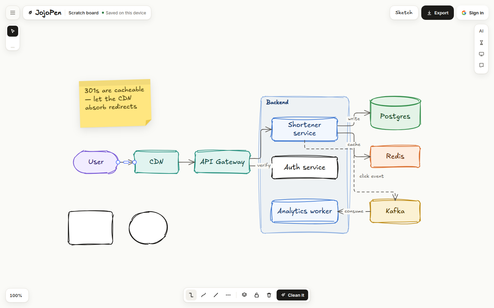

- **Elbow route**, **Curved route**, **Straight**.
- **Dashed (async)** toggle.
- Layer order, lock, delete, Clean it.

**Arrangement**: group/ungroup (`Ctrl+G` / `Ctrl+Shift+G`), nudge (`←↑→↓`, Shift = 1 px), duplicate (`Ctrl+D`), copy/cut/paste, select all (`Ctrl+A`), lock/unlock, z-order (`Ctrl+]` / `Ctrl+[` and Shift variants).

---

## 7. Diagrams and the diagram language

### 7.1 Diagram code panel

`Ctrl+E` or the rail code icon opens **Diagram code** on the right. With a diagram selected (or after **New diagram**) it shows a live, syntax-highlighted DSL editor.

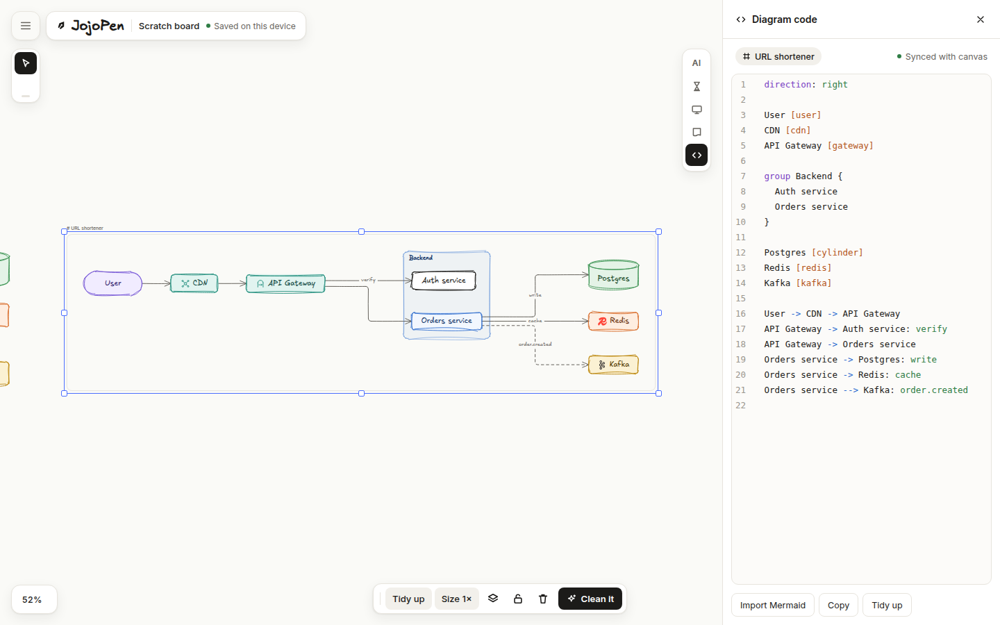

Observed anatomy:

- Header: `</> Diagram code`, close button.
- A chip with the diagram title (`# URL shortener`) and status **“Synced with canvas”**.
- Line-numbered editor with syntax highlighting (keywords, roles, strings).
- Footer actions: **Import Mermaid**, **Copy**, **Tidy up**.
- Empty state: “Select a diagram to edit its code, or start one. Write structure only — colors and layout are automatic.” + **New diagram** + **Import Mermaid**.

**The language** (as generated by “New diagram”):

```text
direction: right

User [user]
CDN [cdn]
API Gateway [gateway]

group Backend {
  Auth service
  Orders service
}

Postgres [cylinder]
Redis [redis]
Kafka [kafka]

User -> CDN -> API Gateway
API Gateway -> Auth service: verify
API Gateway -> Orders service
Orders service -> Postgres: write
Orders service -> Redis: cache
Orders service --> Kafka: order.created
```

- `direction:` controls layout direction.
- `Name [role]` assigns a semantic role; roles drive icon + colour (e.g. `[user]`, `[cdn]`, `[gateway]`, `[cylinder]`, `[redis]`, `[kafka]`).
- `group Name { … }` creates a labelled container.
- `a -> b: label` is a directed edge; `-->` is an async/dashed edge.
- Colours, spacing, icons and routing are automatic. Editing the code re-renders the canvas live; **Tidy up** re-runs layout.

### 7.2 New diagram

“New diagram” generates a starter diagram (URL shortener) with a full DSL program — a good demonstration of roles, groups, labels, and async edges.

### 7.3 Mermaid import

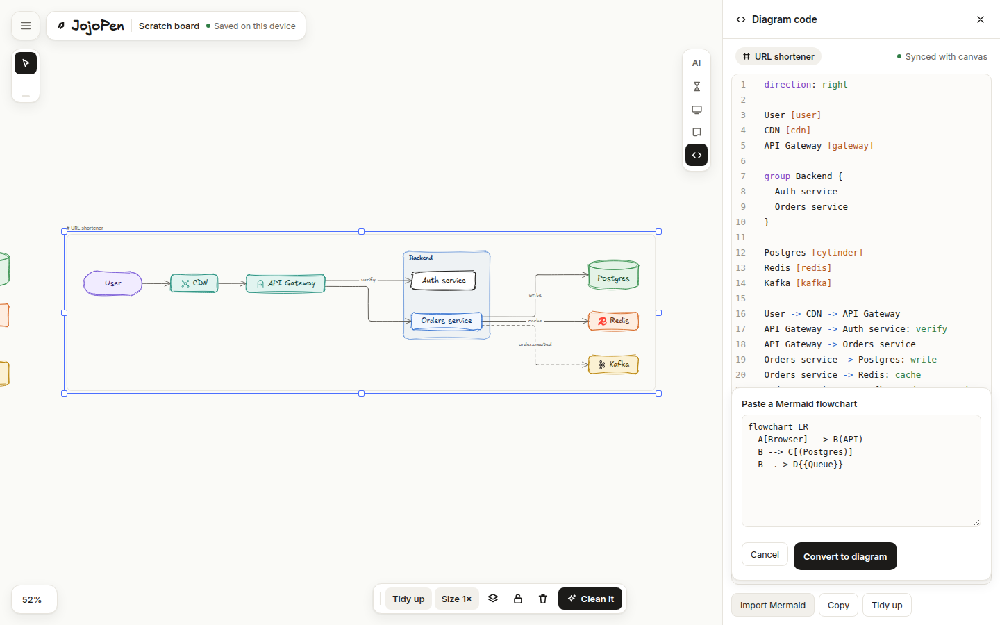

- Dialog: **“Paste a Mermaid flowchart”** with a textarea (placeholder `flowchart LR / A[Browser] --> B(API) ...`).
- Buttons: **Cancel**, **Convert to diagram**, plus **Copy**.
- Supports flowchart syntax: node shapes `[ ]`, `( )`, `(( ))`, `{ }`; edges `-->` and `-.->`.

---

## 8. Slides, builds and presenting

Slides are **frames placed on the board**, 16:9 (1280×720 units). Anything drawn inside a frame belongs to the slide.

### 8.1 Slides panel

`Ctrl+Shift+S` or the rail slide icon.

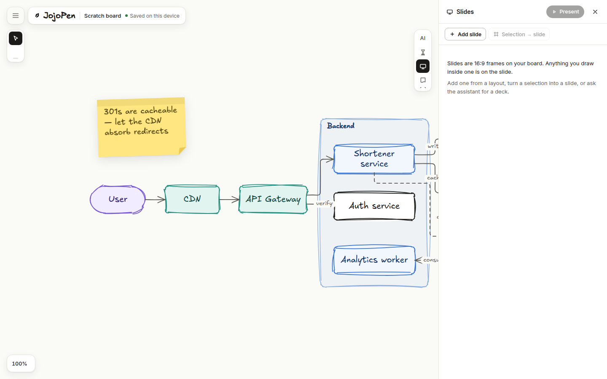

- Header: **Slides** with a count, **Present** button, close.
- **Add slide** opens the layout picker; **Selection → slide** converts the current selection into a slide.
- Empty state: “Slides are 16:9 frames on your board. Anything you draw inside one is on the slide. Add one from a layout, turn a selection into a slide, or ask the assistant for a deck.”

### 8.2 Layouts

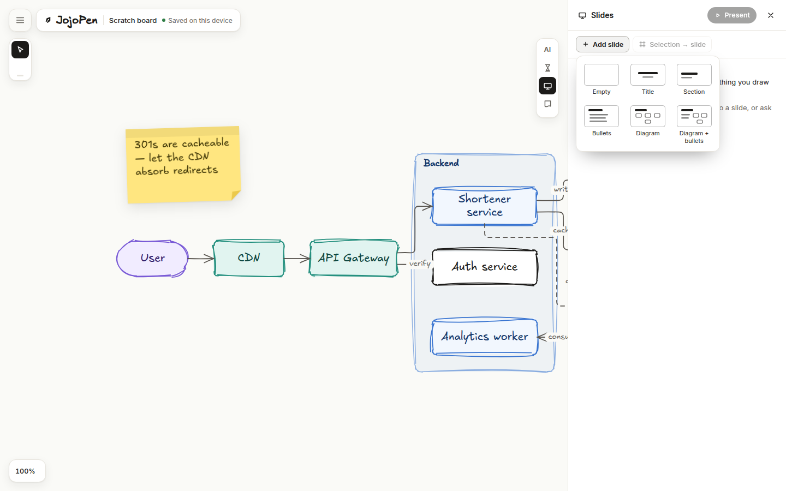

Six layouts, each with a mini diagram:

| Layout | Purpose |
|---|---|
| Empty | Blank 16:9 frame |
| Title | Large title + subtitle |
| Section | Section divider |
| Bullets | Title + bullet list |
| Diagram | Full-bleed diagram area |
| Diagram + bullets | Split: diagram left, bullets right |

Layout geometry (from the bundle): 1280×720 unit, title at `y+253` size 69, subtitle `y+373` size 29, bullets title `y+64` size 48, body `x+88 y+187` size 29; diagram areas 147→667 and 533→1200 for the split layout.

### 8.3 Slide inspector: builds + speaker notes

Selecting a slide (or adding one) reveals the inspector in the slides panel.

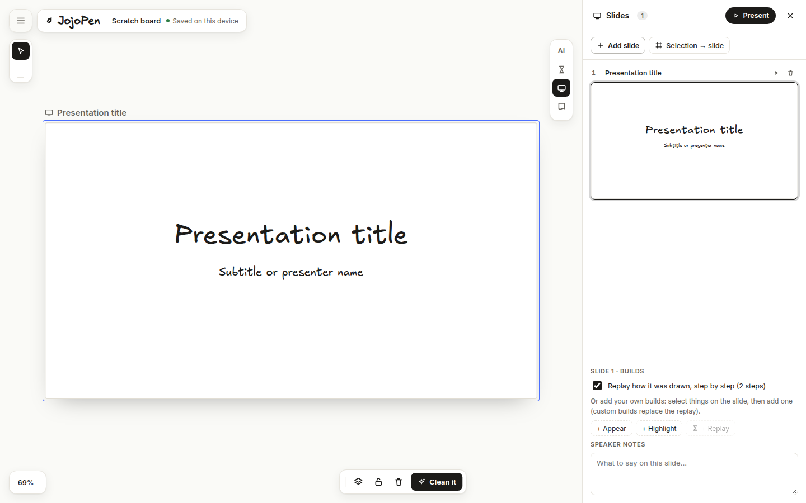

- Thumbnails list with a play button and a delete button per slide.
- **BUILDS**:
  - Checkbox **“Replay how it was drawn, step by step (N steps)”** — the slide's elements are revealed in creation order.
  - “Or add your own builds: select things on the slide, then add one (custom builds replace the replay).”
  - Buttons: **+ Appear**, **+ Highlight**, **+ Replay**.
- **SPEAKER NOTES**: a textarea (“What to say on this slide…”), persisted with the slide.
- Slide thumbnails update live while you draw.

### 8.4 Presenting

`Ctrl+Enter` or **Present**.

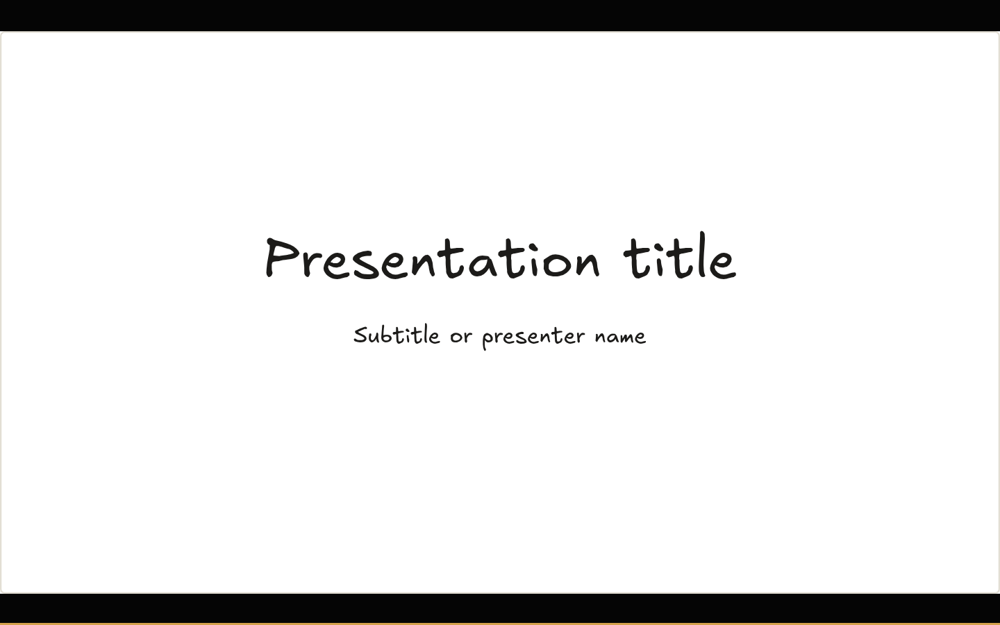

- Fullscreen letterboxed 16:9 stage (black surround), auto-fit scale.
- Minimal floating control pill: previous, `1 / N` indicator, overflow menu, next, exit.
- Navigation: **→ / Space / PageDown** next, **← / PageUp** previous, **Esc** exit.
- Builds: with “Replay how it was drawn” enabled the slide starts empty and reveals elements step by step; the replay honors the recording timings.
- Speaker notes are shown in the slides panel while presenting (presenter view).
- Laser pointer tool is available during a talk.

> Observed quirk: with builds replay enabled, a freshly added title slide presented as an empty frame in headless Chrome until the replay was triggered; unchecking the replay checkbox showed the slide immediately. See §16.

### 8.5 Slide export

When slides exist, the export dialog gains a **Slides (N)** scope and downloads one PNG per slide (`Download 1 PNG`, `Download N PNGs`).

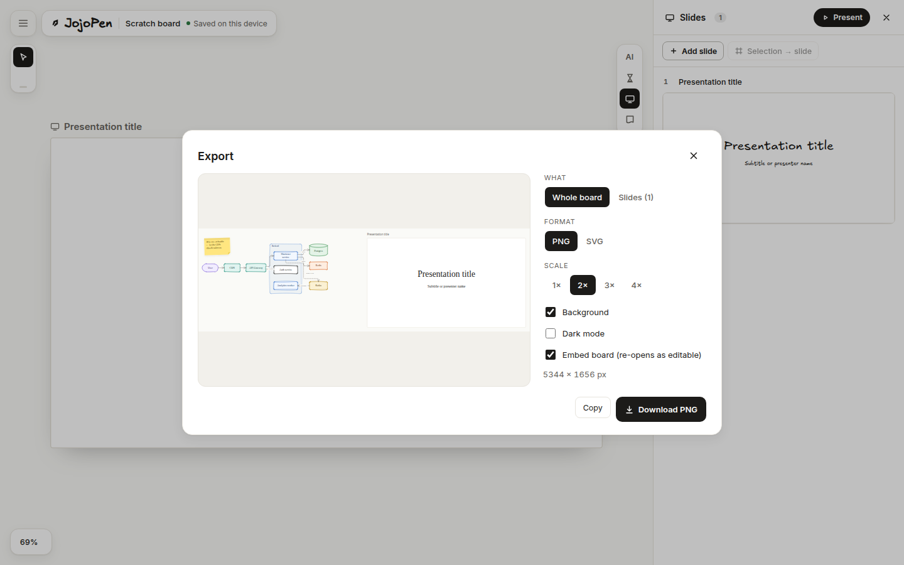

---

## 9. Sands of Time — recording and replay

This is JojoPen's “recording” feature. It records **drawing actions on the board** (not the screen or a camera), then replays them as an animation.

### 9.1 Recording

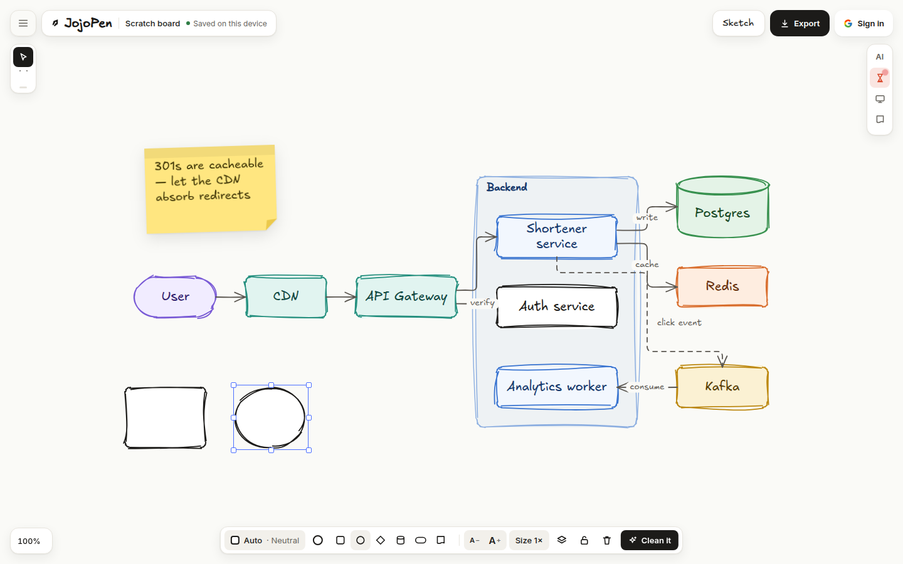

1. Click the **hourglass** in the right rail. Its tooltip/`aria-label` becomes **“Stop recording (N steps so far)”**, the icon turns red, and a toast says:
   > “Sands of Time: recording — click the hourglass again to stop”
2. Draw normally (shapes, stickies, arrows, labels…). Steps are counted live. The counter follows *history steps*, not objects: in one run two drawn shapes reported “3 steps”, because each create/resize pair can land as its own entry.
3. Click the hourglass again to stop.

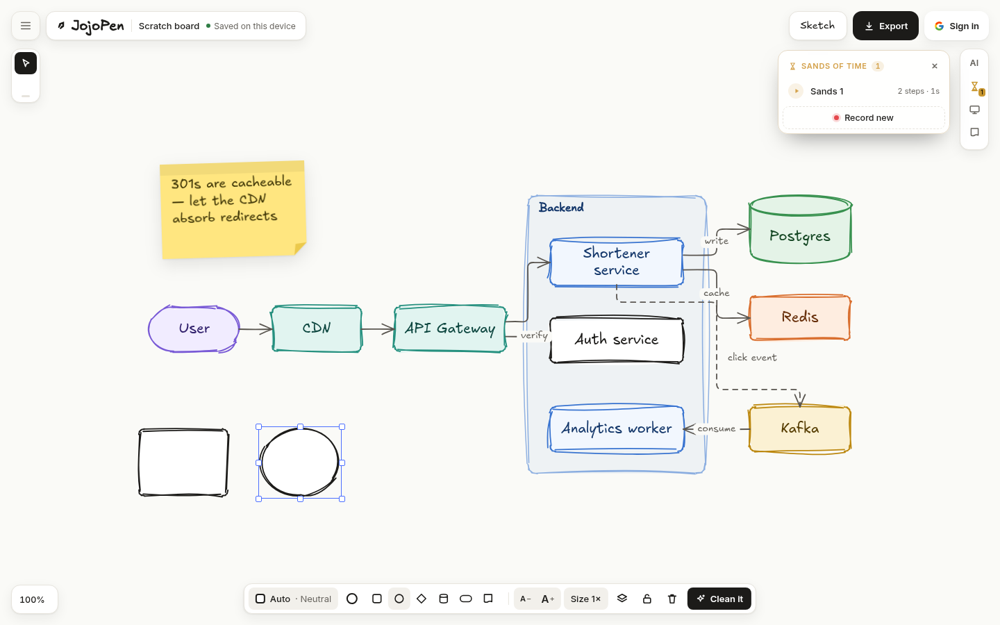

The **Sands of Time** card appears top-right:

- Header with hourglass icon, recording count, close.
- Empty state: *“Record what you draw, then rewind and watch it come back.”*
- Rows: `Sands 1 · 2 steps · 1s`, play button, delete button.
- **Record new** starts another take.

**Session-only.** Recordings live in memory for the open tab: they are *not* written to `localStorage` or IndexedDB (verified — after a reload the rail goes back to “Sands of Time — record what you draw”, there is no card, and the stored doc has no `recordings` field). The rail shows the state in its label and class: `cp-sotbtn is-off` (idle), `cp-sotbtn is-recording` → *“Stop recording (N steps so far)”*, `cp-sotbtn is-off has-saved` → *“Sands of Time — 1 recording”*.

> **Rebuild note.** `index.html` keeps recordings in the board document instead, so they survive reloads; everything else (labels, card, player) matches.

### 9.2 Replay

Click a recording row (tooltip `Replay Sands 1`).

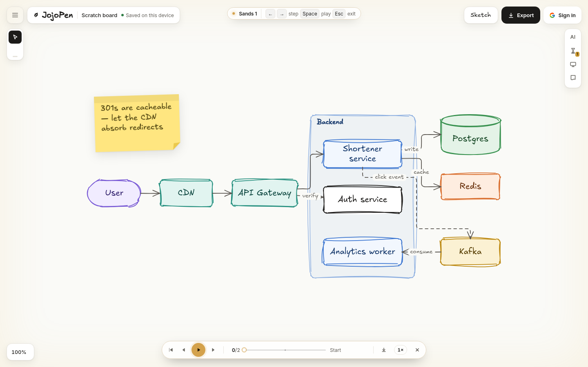

- Top pill: `Sands 1` + hints `← → step`, `Space play`, `Esc exit`.
- Bottom player: previous / play / next, a **step scrubber** (`0/2`) with ticks, `Start`, **speed 1× → 2× → 4×**, export, exit.
- Replay reconstructs the drawing frame by frame; stepping is deterministic and scrubbable.

> **Rebuild note.** `index.html` shows the replay as a focused overlay: the live canvas fades out, a fixed-size stage sized to the union of all frames holds the scene (so the card never jumps), and the board style/theme controls hide themselves. Arrow keys, `Space`, `Home`, `End` and `Esc` work exactly as above.

### 9.3 Export a recording

The export button in the replay player opens a menu:

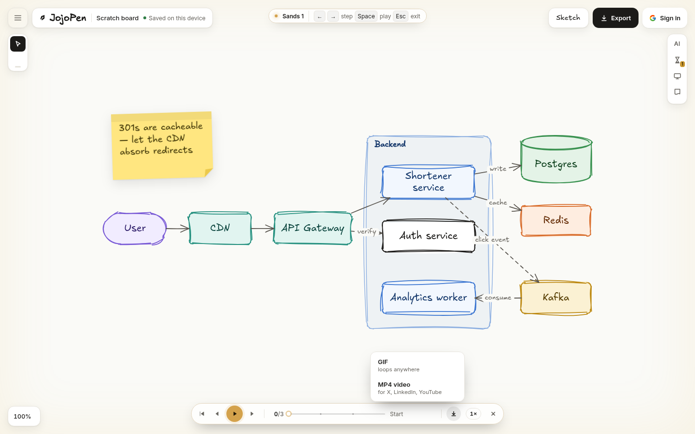

- **GIF** — “loops anywhere”.
- **MP4 video** — “for X, LinkedIn, YouTube” (encoded with WebCodecs; the option only appears when the browser can encode H.264 at that size).

Frames are rendered from the vector document at each step, so output is crisp at the chosen dimensions (capped scale, even dimensions).

> **Rebuild note.** The reconstruction writes GIF89a files itself (median-cut palette over all frames, 8-bit LZW with `NETSCAPE2.0` looping) and encodes MP4 with `canvas.captureStream()` + `MediaRecorder` (`video/mp4;codecs=avc1`), so it works without any external library. Verified sizes and frame counts are in [§15.1](#151-reconstruction-checks-indexhtml).

---

## 10. AI assistant, Clean it and MCP

### 10.1 Assistant panel

`Ctrl+I` or the AI rail button.

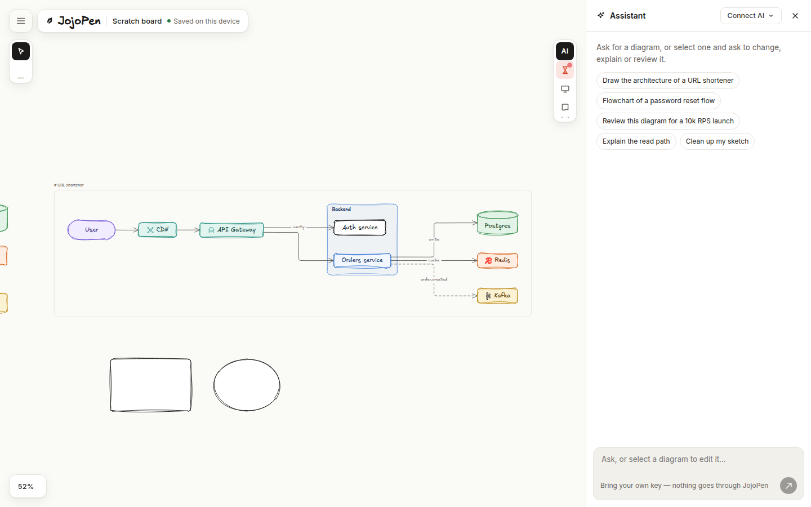

- Header: **Assistant**, **Connect AI** chip, close.
- Intro: “Ask for a diagram, or select one and ask to change, explain or review it.”
- Suggestion chips:
  - “Draw the architecture of a URL shortener”
  - “Flowchart of a password reset flow”
  - “Review this diagram for a 10k RPS launch”
  - “Explain the read path”
  - “Clean up my sketch”
- Composer at the bottom, placeholder “Ask, or select a diagram to edit it…”.
- Footer promise: **“Bring your own key — nothing goes through JojoPen”**.

The assistant can return a whole diagram (the board is replaced/updated) or operate on the current selection.

### 10.2 Connect AI (BYO key)

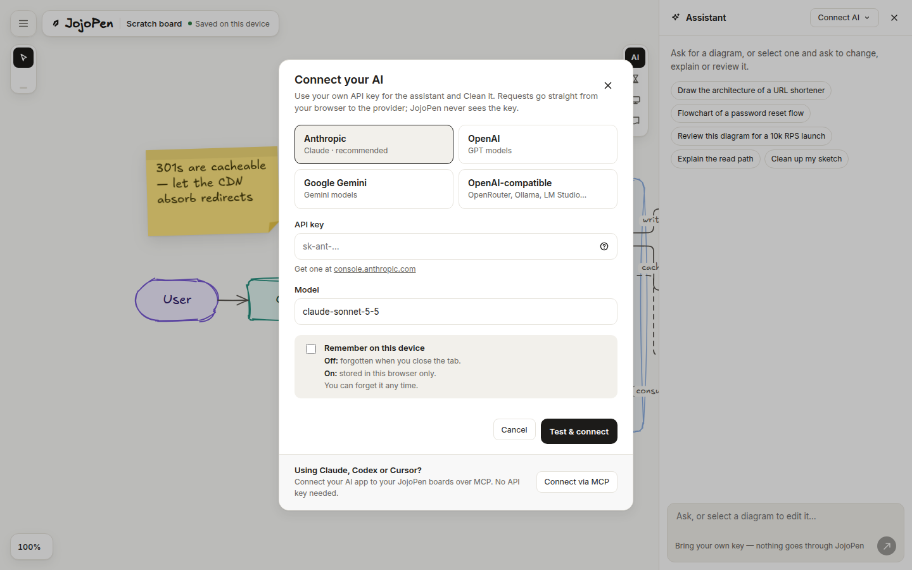

- Providers: **Anthropic** (Claude, recommended), **OpenAI** (GPT), **Google Gemini**, **OpenAI-compatible** (OpenRouter, Ollama, LM Studio…).
- **API key** field with reveal toggle and a provider-specific “Get one at …” link.
- **Model** field (default shown: `claude-sonnet-5-5`).
- **Remember on this device** checkbox — off: forgotten when the tab closes; on: stored in this browser only (IndexedDB database `jojopen`); can be forgotten any time.
- **Cancel** / **Test & connect**.
- Footer: “Using Claude, Codex or Cursor? Connect your AI app to your JojoPen boards over MCP. No API key needed.” → **Connect via MCP**.

### 10.3 Clean it

`Ctrl+Shift+K` (“Clean it — AI presentation layout”). With a key connected it restructures the current diagram for presentation (spacing, grouping, emphasis). Without a key it routes to the Connect dialog. A small “Clean it result” toolbar can appear after a run.

### 10.4 MCP

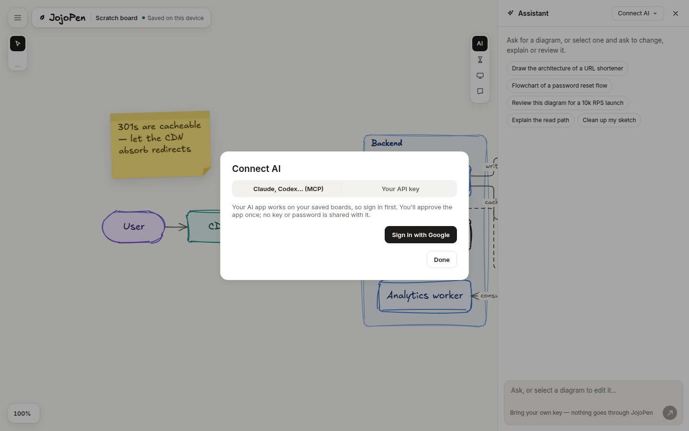

Two tabs: **“Claude, Codex… (MCP)”** and **“Your API key”**.

> “Your AI app works on your saved boards, so sign in first. You'll approve the app once; no key or password is shared with it.”

Requires sign-in; then an external AI app connects to your boards over MCP. **[gated]**

---

## 11. Export

`Ctrl+Shift+E` or **Export**.

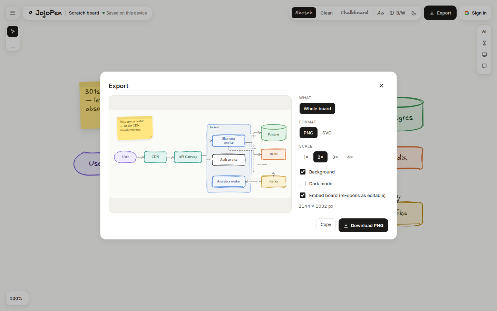

| Option | Values |
|---|---|
| **WHAT** | `Whole board` · `Selection` (when something is selected) · `Slides (N)` (when slides exist) |
| **FORMAT** | `PNG` · `SVG` |
| **SCALE** | `1×` `2×` `3×` `4×` (PNG only; hidden for SVG) |
| **Background** | checkbox, on by default |
| **Dark mode** | render with the dark palette |
| **Embed board (re-opens as editable)** | PNG only; embeds the board JSON so the image can be reopened in JojoPen |
| Size readout | e.g. `2144 × 1032 px`, `1088 × 548 px`, `5344 × 1656 px` |
| Actions | **Copy** (clipboard) · **Download PNG / Download SVG / Download N PNGs** |

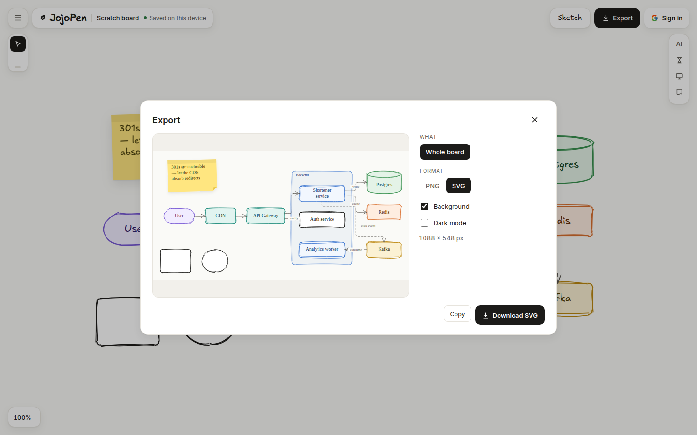

SVG exports at intrinsic size (no scale), with a “Download SVG” action. When exporting slides, PNG is the natural format (one file per slide).

Clipboard failures surface as “The browser blocked the clipboard — use Download”; encoding failures as “Export failed — see console”.

---

## 12. Boards, accounts and sharing

### 12.1 Anonymous scratch board

Without an account the app opens a single board named **“Scratch board”**, marked **“Saved on this device”**. The document is stored in `localStorage` and survives reloads. All core editing, diagrams, slides, recording and export work here.

**First-run boot order** (`src/lib/firstRun.ts`, `bootStore` in `src/state/store.ts`):

1. A `#/b/<id>` hash link or the saved `jojopen.doc.v1` board wins when present — an existing (even empty) port board is never overwritten.
2. Otherwise the live site's `jojopen:scratch:v2` record is imported read-only through `normalizeDoc` when it parses and has elements; the live key is never written.
3. Otherwise the URL-shortener demo is seeded from `TEMPLATES.system` (diagram plus a “301s are cacheable” sticky note) and persisted immediately to the port's own keys, so a reload keeps it and the demo is never seeded twice.

Edits to an imported or seeded board persist through the port's keys (`jojopen.doc.v1`, `jojopen.boards.v1`, `jojopen.current.v1`, per-board copies).

### 12.2 Sign in

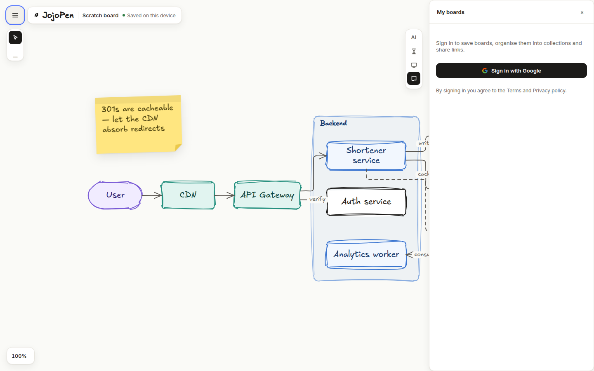

- **Sign in** uses **Google OAuth** (redirect to `accounts.google.com`, then back).
- **My boards** (rail) opens a panel: “Sign in to save boards, organise them into collections and share links.” → **Sign in with Google**, with Terms/Privacy links. **[gated]**

### 12.3 Signed-in features (from bundle, gated)

- Multiple boards, board rename, “Rename or change link”.
- **Share** popover: “Who can see this board” visibility control; public boards; “Share → Public”.
- **Collections** and profile pages; board URLs of the form `/username/collection/slug`, profile routes `/username`.
- Cloud sync and sharing links.
- **MCP** pairing for Claude/Codex/Cursor.

---

## 13. Persistence and data model

| Store | Key / DB | Contents |
|---|---|---|
| localStorage | `jojopen:scratch:v2` | Whole scratch board JSON: `{ version: 1, type: "jojopen", board: { id, name, schemaVersion, settings, elements, files } }` |
| IndexedDB | `jojopen` (v1) | Single object store `keys` — AI provider keys (“Remember on this device”) |
| Memory only | — | Sands of Time recordings (frames + labels); lost on reload |

Document shape (dumped from the live app):

```js
{
  version: 1,
  type: 'jojopen',
  board: {
    id, name, schemaVersion: 1,
    settings: { style: 'sketch', colorMode: 'soft', theme: 'light',
                showGrid: false, showLegend: false, snapToGrid: true,
                gridSize: 16, palette: 'roles' },
    elements: { [id]: { id, type, version: 1, x, y, width, height, index: 'a06',
                        angle: 0, frameId: null, groupIds: [],
                        role, shape, color: null, colorLocked: false,
                        locked: false, label, text, meta } },
    files: { ... }             // images / uploaded assets
  }
}
```

Slides are elements of type `slide`; their children reference `frameId`. Builds and speaker notes live on the slide element (`notes`, `builds`).

Element types include `slide`, `shape`, `text`, `sticky`, `image`, `freehand`, `container`, `diagram`, `arrow`. Slide frames are elements; their children reference `frameId`. Builds store appear/highlight/replay steps plus timings from the recorder.

---

## 14. Keyboard shortcuts

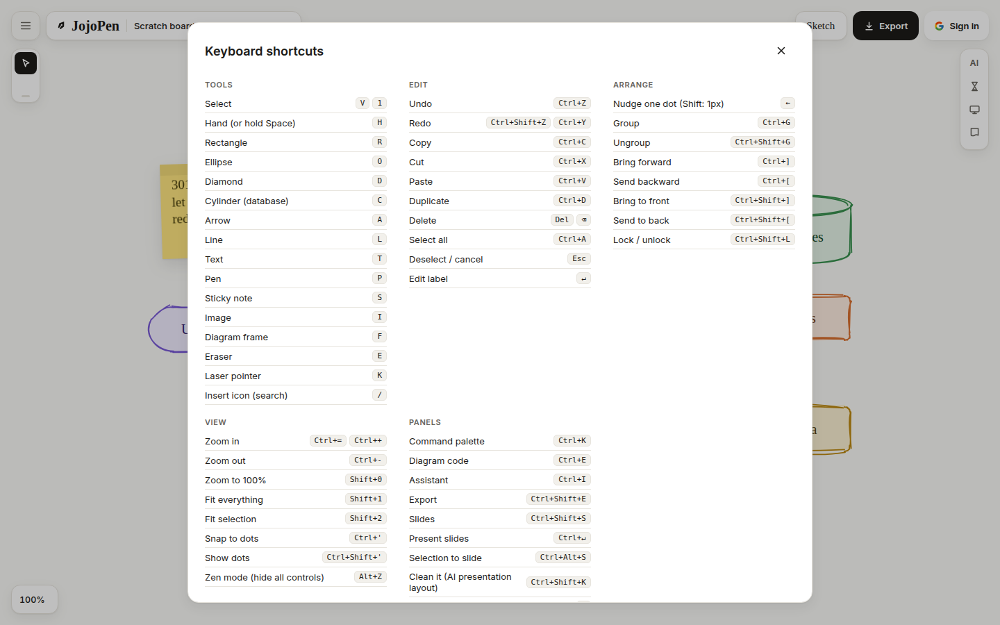

Opened by `?` or the hamburger. Verbatim from the live sheet:

**Tools**

| Action | Keys |
|---|---|
| Select | `V` `1` |
| Hand (or hold Space) | `H` |
| Rectangle | `R` |
| Ellipse | `O` |
| Diamond | `D` |
| Cylinder (database) | `C` |
| Arrow | `A` |
| Line | `L` |
| Text | `T` |
| Pen | `P` |
| Sticky note | `S` |
| Image | `I` |
| Diagram frame | `F` |
| Eraser | `E` |
| Laser pointer | `K` |
| Insert icon (search) | `/` |

**Edit**

| Action | Keys |
|---|---|
| Undo | `Ctrl+Z` |
| Redo | `Ctrl+Shift+Z` `Ctrl+Y` |
| Copy | `Ctrl+C` |
| Cut | `Ctrl+X` |
| Paste | `Ctrl+V` |
| Duplicate | `Ctrl+D` |
| Delete | `Del` `Backspace` |
| Select all | `Ctrl+A` |
| Deselect / cancel | `Esc` |
| Edit label | `Enter` |

**Arrange**

| Action | Keys |
|---|---|
| Nudge one dot (Shift: 1 px) | `←` |
| Group | `Ctrl+G` |
| Ungroup | `Ctrl+Shift+G` |
| Bring forward | `Ctrl+]` |
| Send backward | `Ctrl+[` |
| Bring to front | `Ctrl+Shift+]` |
| Send to back | `Ctrl+Shift+[` |
| Lock / unlock | `Ctrl+Shift+L` |

**View**

| Action | Keys |
|---|---|
| Zoom in | `Ctrl+=` `Ctrl++` |
| Zoom out | `Ctrl+-` |
| Zoom to 100% | `Shift+0` |
| Fit everything | `Shift+1` |
| Fit selection | `Shift+2` |
| Snap to dots | `Ctrl+'` |
| Show dots | `Ctrl+Shift+'` |
| Zen mode (hide all controls) | `Alt+Z` |

**Panels**

| Action | Keys |
|---|---|
| Command palette | `Ctrl+K` *(see §16 — placeholder)* |
| Diagram code | `Ctrl+E` |
| Assistant | `Ctrl+I` |
| Export | `Ctrl+Shift+E` |
| Slides | `Ctrl+Shift+S` |
| Present slides | `Ctrl+Enter` |
| Selection to slide | `Ctrl+Alt+S` |
| Clean it (AI presentation layout) | `Ctrl+Shift+K` |
| Keyboard shortcuts | `?` |

Footer hint on the sheet: *“Hold Space to pan · hold Alt while dragging to place freely · scroll to pan, pinch or Ctrl+scroll to zoom”*.

---

## 15. Rigorous test log

All checks were executed against the live site. **0 console errors, 0 failed requests** in every run.

| # | Area | Action | Result | Evidence |
|---|---|---|---|---|
| 1 | Boot | Load `/` | Scratch board with URL-shortener diagram, “Saved on this device” | `01-board.png` |
| 2 | Chrome | Hover left rail | Toolbar expands to 15 tools | `02-toolbar.png` |
| 3 | Style | Click Clean | Straight-stroke render | `03-style-clean.png` |
| 4 | Style | Click Chalkboard | Dark chalkboard render | `04-style-chalkboard.png` |
| 5 | Colour | Toggle B/W | All colours off, hierarchy preserved | `05-bw.png` |
| 6 | Theme | Toggle dark | Dark canvas/ink | `06-dark.png` |
| 7 | Export | Open dialog | WHAT/FORMAT/SCALE/Background/Dark/Embed + live size | `07-export.png` |
| 8 | Export | Add slide → open | WHAT gains “Slides (1)” | `08-export-slides.png` |
| 9 | Export | Format SVG | Scale hidden, Download SVG | `09-export-svg.png` |
| 10 | Select | Click CDN node | Handles + node format bar (colour, morph, size, layer, lock, delete, Clean it) | `10-selection.png` |
| 11 | Select | Click an edge | Elbow/curved/straight, dashed-async, layer, lock, delete | `11-edge.png` |
| 12 | Code | New diagram | DSL with roles, group, labels, async edge; “Synced with canvas” | `12-code.png` |
| 13 | Code | Import Mermaid | Dialog with textarea and Convert to diagram | `13-mermaid.png` |
| 14 | Slides | Open panel | Empty state + Add slide / Selection → slide | `14-slides-panel.png` |
| 15 | Slides | Add slide | Six layouts | `15-layouts.png` |
| 16 | Slides | Title layout | Slide frame on canvas + inspector with builds and speaker notes | `16-slide-builds.png` |
| 17 | Present | Present title slide | Fullscreen 16:9 slide, control pill, notes | `17-present.png` |
| 18 | Record | Start, draw 2 shapes | Red hourglass, live step count, recording toast | `18-recording-active.png` |
| 19 | Record | Stop | Sands card with `Sands 1 · 2 steps · 1s`, Record new, delete | `19-recordings.png` |
| 20 | Replay | Play recording | Step scrubber 0/2, play/step, speed, exit | `20-replay.png` |
| 21 | Replay | Export menu | GIF / MP4 video | `21-replay-export.png` |
| 22 | Icons | Press `/` | Searchable icon grid, Tab/Enter, Icon only | `22-icons.png` |
| 23 | Frame | Draw with `F` | Titled `# Diagram` frame + Tidy up | `23-frame.png` |
| 24 | View | `Alt+Z` | Zen mode hides chrome | `24-zen.png` |
| 25 | AI | `Ctrl+I` | Assistant with suggestions and composer | `25-assistant.png` |
| 26 | AI | Connect AI | 4 providers, key, model, remember toggle, Test & connect | `26-connect-ai.png` |
| 27 | AI | Connect via MCP | MCP tab + sign-in requirement | `27-mcp.png` |
| 28 | Boards | My boards | Sign-in gate (Google) | `28-boards.png` |
| 29 | Shortcuts | `?` | Full 3-column sheet | `29-shortcuts.png` |
| 30 | Palette | `Ctrl+K` | Toast: “Command palette arrives in step 7” | `30-palette.png` |
| 31 | Persistence | Reload | Board, styles and slides restored from `jojopen:scratch:v2`; recordings are dropped (memory-only) | state dump |
| 32 | Sign in | Click | Redirects to Google OAuth (no in-app errors) | observed |

Additional verified behaviours not pictured: undo/redo, duplicate, grouping, snapping, fit/zoom, text editing, sticky inline editor, freehand and eraser, image tool opening the file picker, board title/URL routing for guests (`/`), and localStorage/IndexedDB keys.

### 15.1 Reconstruction checks (`legacy/index.html`)

The single-file rebuild is driven by the same CDP harness. Every run finished with **0 console errors and 0 failed requests**.

| # | Area | Action | Result |
|---|---|---|---|
| R1 | Record | Hourglass → draw rectangle → ellipse → sticky → hourglass | Rail turns red with a live count; 4 frames stored (`Start`, `add rectangle`, `add ellipse`, `add sticky`); card shows `Sands 1 · 3 steps` |
| R2 | Persist | Reload the file | Recording still listed, replayable from the rail |
| R3 | Replay | Row click, then `→` `→` `←` `Home` `End` `Space` `Esc` | Position `0/3 → 1/3 → 2/3 → 3/3 → 2/3 → 0/3 → 3/3`, space plays/pauses, Esc leaves the overlay and restores the board |
| R3b | Record lifecycle | Draw → move → delete while recording | Frames labelled `Start`, `add rectangle`, `move`, `delete`; node counts per frame `0/1/1/0`, so removals replay too |
| R4 | Replay UI | Step through frames | Fixed stage sized to the union of all frames, so the card does not jump; live board hidden behind it |
| R5 | GIF | Export from the replay bar | `sands-1.gif`, 720×324, 3 frames, delays 500/1370/900 ms; `ffprobe` decodes with no LZW errors |
| R6 | GIF fidelity | Synthetic 400×300 index image → GIF → raw decode | 0 mismatched pixels of 120 000 (median-cut palette + LZW are exact) |
| R7 | MP4 | Export from the replay bar | `sands-1.mp4`, H.264 (`avc1`), 1080×484, 3 frames, 1.93 s, plays in `ffmpeg` |
| R8 | Mermaid | Code panel → Import Mermaid → `flowchart TD` with `subgraph` | DSL with `group Backend { … }`, shapes `[ellipse]`, `[diamond]`, `[cylinder, data]`, labelled edges; diagram added and code panel synced |
| R9 | Builds | Slide inspector → Builds on → Replay | Presenter opens with 0 children (`steps 0`); Space reveals 1 |
| R10 | Themes | Replay in dark mode | Stage background `#0f0f0f`, ink flips, no stray light-on-light text |

---

## 16. Quirks, gaps and unshipped features

These are things that look like features in the UI but behave differently, or that a reimplementation should know about:

1. **Command palette is a placeholder.** `Ctrl+K` shows a toast: **“Command palette arrives in step 7”**. It is listed in the shortcut sheet but not implemented in this build.
2. **The hamburger is not a menu.** `aria-label="Main menu"` opens the keyboard-shortcut sheet, not a File/Edit menu.
3. **Hover-revealed chrome.** Toolbar and style controls are hidden (`.cp-more`) until the rail/top-right is hovered. Screen-reader/automation labels exist, but `element.click()` is not enough — real pointer movement is required.
4. **Presentation with builds starts empty.** With “Replay how it was drawn” checked, a slide presented as a blank frame in headless Chrome until the replay was triggered; unchecking the replay showed content immediately. Likely an interaction/timing issue around the build replay, worth handling explicitly in a clone.
5. **No node right-click menu.** Right-clicking an element shows nothing; all actions are in the bottom format bar.
6. **Sign-in is a full OAuth redirect.** Clicking “Sign in” leaves the SPA (Google account page). All cloud features are consequently untestable without an account.
7. **Whole-board export includes slide frames.** With a slide present the computed export size jumped to `5344 × 1656` because the whole-board bounds include the distant slide frame; “Slides (N)” is the intended scope for decks.
8. **SVG ignores scale and embed.** Scale 1–4× and “Embed board” are PNG-only; SVG is intrinsic-size vector.
9. **MP4 depends on WebCodecs.** The MP4 option is feature-detected (`avc` encoding at the target size); on unsupported browsers only GIF is offered, with the error “This browser can't encode MP4 at this size. Try GIF.”
10. **Recording captures draw steps, not cursor motion.** It reconstructs elements frame-by-frame; it is not a screen/video capture. Step count follows history entries (a single drag can produce create + resize), and replay timing comes from recorded timestamps.
11. **Recordings are memory-only.** They never reach `localStorage` (the doc has no `recordings` field) or IndexedDB (only a `keys` store for AI credentials). Reloading the tab silently drops them — the rail returns to “Sands of Time — record what you draw”.
12. **Anonymous mode is one board.** No local board list; “My boards” is strictly a sign-in gate.

---

## 17. References

### 17.1 Production assets

| Asset | URL |
|---|---|
| App HTML | `https://jojopen.com/` |
| Main bundle | `https://jojopen.com/assets/index-CBB3_Z2F.js` (≈1.1 MB, React 19 + Vite) |
| Stylesheet | `https://jojopen.com/assets/index-BFfrwbpL.css` |
| Lazy chunks | `AssistantPanel-CQEQpERj.js`, `ConnectDialog-9eNeZgfb.js`, `CodePanel-CMqb15nT.js`, `cleanIt-BxoCJKWf.js`, `tools-BonGdsAw.js`, `gifenc.esm-BWxMhepS.js` |
| Diagram layout engine | ELK (`elk.bundled-*.js`, layered/orthogonal routing) |

### 17.2 Strings that pin down behaviour (verbatim from the bundle)

- `Sands of Time: recording — click the hourglass again to stop`
- `Stop recording (${n} step${n === 1 ? '' : 's'} so far)`
- `Sands of Time — record what you draw` / `Sands of Time — 1 recording`
- `Record what you draw, then rewind and watch it come back.`
- `Replay how it was drawn, step by step (${steps} steps)`
- `Export as GIF or video` / `GIF — loops anywhere` / `MP4 video — for X, LinkedIn, YouTube`
- `Command palette arrives in step 7`
- `Bring your own key — nothing goes through JojoPen`
- `Your AI app works on your saved boards, so sign in first.`
- `Who can see this board` / `Share` / `Share → Public`
- `Embed board (re-opens as editable)`
- `The browser blocked the clipboard — use Download`

### 17.3 DOM hooks used for testing

| Selector | Element |
|---|---|
| `.cp-canvas`, `.cp-world` | Canvas + transformed world |
| `.cp-toolbar`, `.cp-rail`, `.cp-topright` | Chrome groups (collapsible) |
| `.cp-boardname`, `.cp-saved`, `.cp-pill` | Board identity + status |
| `.cp-seg`, `.cp-bwtoggle`, `.cp-fontmenu` | Style/colour/font controls |
| `.cp-secondary.cp-modelchip` | “Connect AI” |
| `.cp-sotcard`, `.cp-sotrow`, `.cp-sottrack`, `.cp-sotspeed` | Recording card & replay player |
| `.cp-sotbtn.is-off` / `.is-recording` / `.has-saved` | Hourglass rail states |
| `.cp-present`, `.cp-present-slide` | Presentation stage |
| `.cp-chat`, `.cp-composer` | Assistant |
| `.cp-notes`, `.cp-slideinspect-title` | Speaker notes/slide inspector |
| `.cp-layermenu`, `.cp-sharepop` | Popovers and share |
| `[aria-label="…"]` | Tools, rail actions, dialogs (see tables above) |

### 17.4 Storage

- `localStorage["jojopen:scratch:v2"]` — complete scratch board JSON.
- `indexedDB.open("jojopen")` — AI credentials when “Remember on this device” is on.

### 17.5 Screenshot index

| File | Feature |
|---|---|
| `docs/img/01-board.png` | Scratch board / default diagram |
| `docs/img/02-toolbar.png` | Expanded tool rail |
| `docs/img/03-style-clean.png` | Clean style |
| `docs/img/04-style-chalkboard.png` | Chalkboard style |
| `docs/img/05-bw.png` | Black & white mode |
| `docs/img/06-dark.png` | Dark theme |
| `docs/img/07-export.png` | Export (PNG) |
| `docs/img/08-export-slides.png` | Export scope “Slides (1)” |
| `docs/img/09-export-svg.png` | Export (SVG) |
| `docs/img/10-selection.png` | Node selection + format bar |
| `docs/img/11-edge.png` | Edge selection + routing |
| `docs/img/12-code.png` | Diagram DSL panel |
| `docs/img/13-mermaid.png` | Mermaid import |
| `docs/img/14-slides-panel.png` | Slides panel |
| `docs/img/15-layouts.png` | Slide layouts |
| `docs/img/16-slide-builds.png` | Builds + speaker notes |
| `docs/img/17-present.png` | Presentation |
| `docs/img/18-recording-active.png` | Recording |
| `docs/img/19-recordings.png` | Recordings card |
| `docs/img/20-replay.png` | Replay player |
| `docs/img/21-replay-export.png` | GIF/MP4 export |
| `docs/img/22-icons.png` | Icon search |
| `docs/img/23-frame.png` | Diagram frame |
| `docs/img/24-zen.png` | Zen mode |
| `docs/img/25-assistant.png` | AI assistant |
| `docs/img/26-connect-ai.png` | Connect your AI |
| `docs/img/27-mcp.png` | MCP connection |
| `docs/img/28-boards.png` | My boards (sign-in gate) |
| `docs/img/29-shortcuts.png` | Keyboard shortcuts |
| `docs/img/30-palette.png` | Command palette placeholder |

---

*Screenshots and measurements come from the live production site; no source code was copied. This document is an independent behavioural specification for the reconstruction in [`legacy/index.html`](legacy/index.html) and its React port in [`src/`](src/).*
